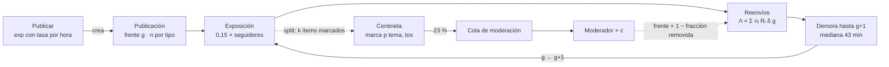

# TP3 · Investigación de Operaciones II · RedBaires

Simulador de eventos discretos para el TP3 de IO II (ITBA, 2º cuatrimestre 2026). El caso es
RedBaires, una red social que factura por impresión y quiere saber qué palanca le conviene
contra la difusión de rumores: más moderadores, un límite a los reenvíos o degradar el alcance
de las cuentas coordinadas.

Por ahora el repo tiene sólo este README: lo decidido, lo que falta decidir con los datos de
cada decisión, los supuestos y el modelo de datos. El código y el notebook de EDA vienen
después.

**Estado al viernes 25/9/2026.**

| Entrega | Qué se produce | Vence |
|---|---|---|
| **TP3A** | modelo conceptual y modelo de datos, máximo 12 páginas | **viernes 2/10, 12:00** |
| TP3B | modelo operacional | 16/10 |
| TP3C | experimentación | 13/11 |

⚠️ Lo que se pregunte en la clase del martes 29/9 tiene que entrar al TP3A esa misma noche.

## Cómo usar el repo

- **Datos:** no están en el repo porque son material de la cátedra. Van en [`datos/`](datos/README.md).
- **Herramienta:** Python.
- **Para decidir:** cada decisión abierta tiene un número (D1 a D20). Con decir «D8: DISARM»
  en el grupo alcanza.

---

## 1. Lo que ya está decidido

| Qué | Decisión | Cuándo | Por qué |
|---|---|---|---|
| Herramienta | Python, no AnyLogic | 13/8 | con tres entregas, el código se trabaja en paralelo y la experimentación del TP3C son cientos de corridas |
| Nombres | la entidad es un sustantivo y el evento, un verbo: **la publicación** es la entidad y **publicar** es el evento que la crea. «Cascada» queda para el árbol de reenvíos de una publicación, que es lo que mide el dataset (`cascade_id`, una por `message_id`) | 25/9 | el enunciado llama «publicación original» a una fila del export; con el verbo para el evento no se confunde entidad con evento |
| Qué puede ser una VR | **una variable de referencia es salida del simulador**: varía entre corridas y se informa con intervalo de confianza | 15/9 | el costo de los moderadores no es VR: con *c* moderadores, la nómina ya está determinada. Es costo de la decisión y va a la evaluación económica |
| Entidad | **la publicación**: la pieza de contenido original (`message_id`), con el frente de reenvíos vivos como atributo | 22/9 | ver D1 |
| Segunda entidad | **el ítem de moderación**, que nace en un split de Centinela | 22/9 | si la publicación hiciera la cola ella misma, dejaría de propagarse mientras espera, y en los datos eso no pasa |

## 2. El modelo en una figura

La fila de arriba es la publicación dando vueltas: se expone, genera el frente siguiente y espera
hasta la generación que viene, mientras le queden reenvíos. La de abajo es la moderación,
que corre en paralelo sobre otra entidad. El TP se juega en la carrera entre las dos: la
publicación salta de generación cada **43 minutos** y la moderación hoy tarda **139** en actuar.

Las tres palancas entran así: los moderadores cambian *c*, el límite de reenvíos multiplica Λ
y la degradación baja el alcance (D12 decide si el 0,15 o el R).

## 3. Modelo conceptual

### D1 · ¿Qué es la entidad? — ✅ la publicación (22/9; el nombre, 25/9)

La consigna prohíbe una entidad por usuario y que la cantidad de entidades crezca con la
difusión.

| Opción | Entidades vivas | Qué pasa |
|---|---|---|
| El reenvío | crece con la difusión | 500 entidades en una cascada de 500. Viola la consigna |
| **La publicación**, con sus reenvíos como atributo | una por rumor activo | sea su cascada de 2 eventos o de 3 millones. Acumula sola tamaño, profundidad e impresiones, que es contra lo que hay que validar |
| Un lote por generación | ≤ rumores × generaciones | muere antes de que llegue la remoción |

El argumento es de tiempos. Hasta la acción pasan **139 minutos** y entre un reenvío y su
hijo, **43**: cuando el moderador abre el ítem, la publicación avanzó unas tres generaciones. Por
eso el **89 %** de los hijos de un evento marcado ya nacieron cuando se actúa. Con el lote por
generación, ese lote está muerto cuando llega la remoción y hay que ir a buscar la publicación
igual.

El costo, que hay que declarar: adentro de una generación no hay orden, y la remoción se
aplica como fracción del frente (D10).

### D2 · ¿Qué recursos tienen capacidad?

| Opción | |
|---|---|
| **Sólo los moderadores** *(propuesta)* | Centinela clasifica en el momento, sin cola ni capacidad |
| Moderadores y Centinela con cola | habría que inventarle a Centinela un tiempo de servicio que los datos no muestran |

Datos: la latencia no se comporta como una cola. No sube con la carga (Spearman **0,022**),
no cambia de noche, no baja para los temas sensibles ni para lo más tóxico, y tiene un piso
duro de **90 minutos**. Ninguna palanca compra velocidad de clasificación, así que el supuesto
no cambia ninguna conclusión.

### D3 · Variables de decisión (la grilla pide al menos 2)

Los números salen de `parametros_y_costos.csv`, que da para cada parámetro un **valor base**
(el de hoy) y un **rango** (lo que se puede evaluar). En la degradación y en el clasificador, lo
que da el CSV es lo que **cuesta** la palanca, no cuánto se la mueve.

| VD | Qué es | Hoy · rango | Lo que cuesta |
|---|---|---|---|
| Moderadores por turno *c* | cuántos revisan la cola a la vez | 1 · 1 a 12 | 22 USD/h × 720 h = 15.840 USD por moderador y por mes |
| Límite de reenvíos: umbral | a partir de cuántos reenvíos acumulados de la publicación se aplica la fricción, estilo «reenviado muchas veces» de WhatsApp | 5 · 1 a 20 | — |
| Límite de reenvíos: reducción | cuánto alcance pierde cada reenvío limitado. Con 0,9, llega al 10 %. En el modelo: Λ × (1 − reducción) | 0 · 0 a 0,9 (hoy no hay fricción) | 15 % del engagement legítimo (2 a 50 %) |
| Degradación de alcance | bajarles el alcance a las cuentas grandes detectadas como coordinadas. **Cuánto y a quién no está en el CSV**: lo supone el grupo (D11, D12) | — | 120 USD por cuenta y por día (20 a 600), en reputación o por contrato |
| Clasificador nuevo | reemplazar Centinela por uno con otra precisión (de lo que marca, cuánto es nocivo) y otro recall (de lo nocivo, cuánto marca) | precisión 0,72 · 0,5 a 0,95; recall 0,63 · 0,3 a 0,9 | capex 250.000 USD (80.000 a 900.000) + 60.000 por año, a 4 años y 10 %: ≈ 11.600 USD por mes, unos 0,7 moderadores |

Las tres primeras son las palancas del memo. Los costos de esta tabla son costos de la
decisión y van a la evaluación económica, no a las VR.

### D4 · Variables de referencia (al menos 2, contrapuestas)

| VR | Qué mide | |
|---|---|---|
| **Impresiones nocivas servidas** | el daño que no se contuvo | *propuesta* |
| **Publicaciones buenas bajadas** | lo que cuesta contener, del lado del usuario | *propuesta* |
| Impresiones legítimas perdidas por fricción | lo que cuesta del lado del negocio | *opcional*: sin esta, la fricción sólo tiene efectos buenos |
| Ítems revisados × 0,12 USD | costo variable de la moderación | es salida: cuántos se revisan lo decide la corrida |
| Tiempo hasta la acción o % dentro del SLA de 120 min | la tensión de filas | sólo si se resuelve la escala (D7) |
| Alcance total contra tamaño de la cascada nociva | la tensión de la fricción | simple, pero no habla de plata |
| ~~Costo de moderadores~~ | | **no es VR** (15/9) |

Las dos primeras se contraponen con una sola VD. Hoy el **43 %** de lo que entra a la cola
es contenido legítimo (6.630 de 15.437 ítems marcados, si nocivo es DISARM): más capacidad
de revisión baja más nocivas y también más buenas.

La economía, con los valores base del CSV sobre los 180 días de la muestra:

| | |
|---|---|
| Ingreso de las impresiones legítimas | 192.000 USD |
| Costo social de las nocivas | 572.000 USD, más 274.000 de churn |
| Una impresión nociva cuesta / una legítima rinde | 0,0059 / 0,0009 USD |
| Bajar una publicación buena | 1,57 USD en la mediana; 87 si es de un difusor masivo |
| **Tipo de cambio** | bajar una publicación buena se paga evitando **266 impresiones nocivas** |
| Frenar una cascada nociva vale | mediana 3 USD · p90 1.076 · p99 6.271 |

El valor está en las pocas cascadas grandes. Moderar en masa las chicas cuesta más en
publicaciones buenas bajadas de lo que evita en daño; eso habrá que confirmarlo simulando.

### D5 · Variables de estado (al menos 2)

| VE | |
|---|---|
| **Ocupación de los moderadores (%)** | obligatoria: la pide la grilla |
| Largo de la cola de moderación | explica el tiempo hasta la acción |
| Publicaciones vivas e ítems en revisión | prueba que el consumo queda acotado, como pide la consigna |
| R efectivo del momento | muestra por qué el sistema explota o se apaga |

⚠️ La grilla anula el punto del diagrama de relación entre variables si ahí se usan
variables de referencia.

### D6 · ¿Qué horizonte se simula?

| Opción | |
|---|---|
| **Un mes de llegadas y el peor episodio del mes** *(propuesta)* | simula el régimen y muestra la cola de riesgo |
| Un solo episodio, sembrado con una cuenta grande | reproduce el caso del memo; no dice cuánto cuesta sostener la palanca |

Los costos vienen por hora, por mes y por año, y el memo cuenta un episodio. Es pregunta
para el tutor.

## 4. Supuestos

Criterio para cerrarlos sin discutir de más, en orden:

1. ¿Lo dice el enunciado? Entonces es dato y se cita.
2. ¿Los datos lo pueden distinguir? Se mide.
3. ¿Alguna palanca actúa sobre eso? Si no, va el más simple y se declara.
4. Si sigue abierto, va el más simple, declarado y dentro del análisis de sensibilidad.

### D7 · ¿Cuál es la escala? 🔴 bloquea la cola

La muestra es un recorte de una plataforma de 7,8 M de usuarios diarios. Con sus volúmenes
entran 86 ítems marcados por día y un moderador revisa 4.320 (a 20 s cada uno): trabaja al
**2 %**. La cola queda vacía, la palanca de los moderadores no mueve nada y la VE obligatoria
queda clavada en 2 %.

| Opción | |
|---|---|
| **Calibrar el volumen a la latencia observada** *(propuesta)* | se sube el volumen hasta que, con la dotación de hoy, la espera mediana dé 139 min. Fija la escala y sirve de validación |
| Simular la muestra tal cual | la primera palanca no tiene efecto |
| Escalar por la proporción muestra / 7,8 M | hay que suponer qué fracción de la plataforma es la muestra |

### D8 · ¿Qué cuenta como «nocivo»? 🔴 bloquea las VR

| Opción | |
|---|---|
| **Por tema: DISARM es nocivo, ORG es legítimo** *(propuesta)* | los códigos DISARM son técnicas de desinformación documentadas ([DISARM Foundation](https://github.com/DISARMFoundation/DISARMframeworks)) |
| Por umbral de `toxicity_index` | hay que elegir y defender el umbral |
| DISARM o toxicidad alta | más fiel, un parámetro más |

Datos: se marca el 32–36 % de los temas DISARM y el 14–22 % de los ORG. Con DISARM, la
precisión y el recall del log dan **0,57 y 0,34**; el CSV declara **0,72 y 0,63**. Ninguna
definición los reproduce, así que los del CSV parecen ser la especificación del clasificador
que se compraría, no el de hoy.

### D9 · ¿Hay prioridad en la cola?

| Opción | |
|---|---|
| **FIFO en el baseline, prioridad por nocividad como escenario** *(propuesta)* | es una palanca gratis que la Dirección no listó |
| Sólo FIFO | menos trabajo |

El enunciado dice que la cola «no es un FIFO puro», pero en los datos la espera no baja ni
para lo más tóxico ni para los temas sensibles. Lo que el enunciado hace variar con el tema
es la probabilidad de remoción, no el orden de atención.

### D10 · ¿Cómo se aplica la remoción al frente?

| Opción | |
|---|---|
| **Fraccional: frente × (1 − fracción removida)** *(propuesta)* | con probabilidad de remoción más baja para las verificadas, como dice el enunciado |
| Todo o nada | más simple; exagera el efecto de moderar |
| Fraccional y ponderado por cuánto del frente ya se reenvió | más fiel, más difícil de explicar |

El CSV registra la marca, no la acción. El 11 % de los hijos de un evento marcado nace
después de la acción, así que no todo lo marcado se remueve.

### D11 · ¿Qué cuenta como coordinada?

| Opción | |
|---|---|
| **Sufijo C2 + cuenta nueva, con error de detección asumido** *(propuesta)* | precisión y recall explícitos |
| Sólo el sufijo C2 | detección perfecta; poco creíble |
| Por tamaño de audiencia | degradar a los BROADCASTER y CREATOR, coordinados o no |

Datos: el sufijo `-C2` de `hashtag_cluster_ref` (514 cascadas) da cascadas de **42,8**
eventos contra ~10 y **13 %** de cuentas nuevas contra 6 %. La huella de dispositivo no
separa: el 98 % aparece en más de tres cascadas, dentro y fuera de C2.

### D12 · ¿Qué baja la degradación?

| Opción | |
|---|---|
| El factor de impresiones (0,15) | menos gente la ve y, por eso, hay menos reenvíos |
| El R de las publicaciones detectadas | actúa directo sobre la propagación |
| Los dos | un parámetro más |

### D13 · ¿Sobre qué actúa el límite de reenvíos?

| Opción | |
|---|---|
| **Por pieza, con los reenvíos acumulados de la publicación** *(propuesta)* | la entidad ya lleva ese contador |
| Por generación | más simple; no es lo que dice el memo |
| Por cuenta | requiere seguir cuentas, cosa que la entidad elegida no hace |

## 5. Modelo de datos

### Lo que tiene la muestra

66.153 eventos en 5.000 cascadas, 30 columnas, 180 días. La documentación de los campos se
perdió y reconstruirla es parte de la nota.

| Columna | Qué es | Cómo lo sabemos |
|---|---|---|
| `reshare_count_from_actor` | hijos del evento | coincide 100 % con contar `parent_event_id` |
| `inter_event_time_min` | minutos desde el padre | coincide 99,8 % con la resta de fechas |
| `cascade_depth` | generación | es la del padre + 1 en el 100 % |
| `content_half_life_min` | vida media | un valor por cascada |
| `topic_code` DISARM-* | técnicas de desinformación: T0003, T0023, T0039, T0049, T0049.003 | marco de DISARM |
| `topic_code` ORG-* | temas orgánicos: POL, HLTH, FIN, CELEB, LOCAL | por contraste. **Hipótesis** |
| `hashtag_cluster_ref` | identificador de campaña | **hipótesis**: el sufijo C2 es coordinación |
| `account_type_code` | BROADCASTER · CREATOR · AGGREGATOR · LURKER · STANDARD | por los roles que nombra el enunciado |
| `moderation_latency_min` | minutos hasta la acción | es **salida**, no entrada: objetivo de validación |
| nano / micro / macro / mega | **no están en los datos** | con cortes de 1k, 10k, 100k y 1M, el 80 % de los eventos queda debajo de todos |

### Lo sucio

| Problema | Cuántos |
|---|---|
| Filas duplicadas | 132 |
| Mayúsculas mezcladas en formato, superficie e idioma (`es` · `ES` · `es-AR`) | ~13.850 celdas |
| Faltantes: `dwell_time_sec` 2.008 · `sentiment_score` 1.347 · `device_fingerprint_code` 1.327 · `comments` 937 · `content_half_life_min` 667 · `impressions` 625 | 7 columnas |
| Fechas en 2099 | 39 |
| Hijos anteriores al padre | 39 |
| Cuentas más viejas que la plataforma (opera desde 2013) | 514 |
| Latencia de moderación mayor a 24 h | 196 |
| `dwell_time_sec` negativo | 66 |
| Cuentas con 0 seguidores | 52 |
| Cuentas con más de un valor de seguidores | 3.627 de 4.000 |

### D14 · ¿Qué se hace con las cascadas cortadas en 500?

Hay 14 cascadas de exactamente 500 eventos, todas C2: el export corta ahí y la cola está
censurada.

| Opción | |
|---|---|
| **Sacarlas para medir R y cortar la simulación en 500 al validar** *(propuesta)* | compara en igualdad de condiciones |
| Dejarlas | subestima el R de las campañas |

### Lo que se midió para las variables aleatorias

| Qué | Número |
|---|---|
| Cascadas de un solo evento | 2.019 de 5.000 (40 %) |
| Tamaño: mediana · p90 · p99 · máx | 2 · 29 · 188 · 500 |
| Hijos por evento (R), sin las truncadas | **0,916** |
| Lo mismo por 1 − 1/tamaño medio | 0,916: el proceso es subcrítico |
| Varianza / media de los hijos | 5,1: no es Poisson simple |
| Hijos por generación | 2,39 · 1,04 · 0,91 · 0,85 · 0,67 · … · 0,37 |
| Hijos por tipo de cuenta | BROADCASTER 4,45 · CREATOR 3,65 · resto ~0,6 |
| Hijos por superficie | DM 0,55 · STORY 0,77 · FEED 0,95 · REPOST 1,03 · GROUP 1,13 |
| Impresiones / seguidores | ≈ 0,15 en los cinco tipos |
| Tasa de «publicar» | 0,51 por hora a las 3 h · 1,62 a las 17 h · promedio 1,16 |
| Eventos marcados por Centinela | 23 % |
| Latencia de moderación | piso 90 · mediana 139 · p90 353 min |

### D15 · ¿Cada cuánto ocurre «publicar»?

| Opción | |
|---|---|
| **Exponencial con tasa según hora y día** *(propuesta)* | es lo que muestran las semillas; obliga a pensar el arranque en frío |
| Exponencial con tasa constante | pierde que la hora cambia el tamaño: 10,4 de 0 a 6 h contra 15,3 de 6 a 12 h |

### D16 · ¿Cómo se sortean los hijos del frente?

| Opción | |
|---|---|
| **Poisson(Λ), con Λ = Σ nᵢ Rᵢ δ(g), un sorteo por generación** *(propuesta)* | se mide contra p90 y p99 y, si no alcanza, se cambia |
| Binomial negativa desde el arranque | captura la sobredispersión (Lloyd-Smith et al., 2005); un parámetro más |

Un solo sorteo por frente se come parte de la sobredispersión: el test que manda es
p90 = 29 y p99 = 188, no el 5,1.

### D17 · ¿De qué tipos de cuenta es el frente hijo?

| Opción | |
|---|---|
| **Multinomial fija, y medir contra el p99 antes de complicarla** *(propuesta)* | simple, pero tiende a volver a la media |
| Condicionada al tipo del padre | usa la matriz padre → hijo de los datos |

Si cada frente se reparte con las proporciones de toda la población, la publicación vuelve al
promedio en una o dos generaciones y la cola larga se aplana. Lo que hace explotar una
cascada es enganchar un BROADCASTER.

### D18 · ¿El contenido se apaga por generación o por tiempo?

| Opción | |
|---|---|
| **Por generación, con δ(g) medido** *(propuesta)* | es lo que muestran los datos |
| Por tiempo, con la vida media | es lo que dice el memo, pero `content_half_life_min` no correlaciona con el tamaño (Spearman 0,04) |

### D19 · ¿Cuánto tarda la publicación en saltar de generación?

Ajuste sobre los 60.754 tiempos positivos entre padre e hijo:

| Distribución | Parámetros | KS (D) |
|---|---|---|
| Gamma | forma 0,55 · escala 128 min | **0,080** |
| Weibull | forma 0,67 · escala 53 min | 0,106 |
| Lognormal | σ 1,98 · mediana 22 min | 0,142 |
| Exponencial = Erlang k = 1 | media 70 min | 0,151 |
| Erlang k = 2 | | 0,274 |

Con tantos datos ninguna pasa el test; importa cuál se acerca más.

La Erlang es una gamma con forma entera (k ≥ 1). La clase 07 la presenta para una actividad
en **fases sucesivas**, cada una exponencial: eso da un coeficiente de variación de 1/√k, o
sea **igual o menor que 1**. Estos tiempos tienen un CV de **3,9** (1,18 sin el 1 % más
extremo), más dispersos que una exponencial. La forma que ajusta es 0,55, y ninguna Erlang
llega ahí: con k = 1 es la exponencial y con k = 2 empeora. La dispersión de más
seguramente viene de mezclar horas y tipos de cuenta distintos.

| Opción | |
|---|---|
| Gamma | la que mejor ajusta |
| Exponencial | la más fácil de defender y la que peor ajusta |
| Empírica, sorteando de los datos | no supone forma; hay que decir qué se hace con los 39 negativos |

Pendiente: repetir el ajuste con el Input Analyzer de la cátedra, que da chi-cuadrado y KS.

### D20 · ¿Cuánto tarda una revisión?

El tiempo de atención no está en los datos: la latencia registrada es espera más atención.
Si los 0,12 USD por ítem son tiempo de moderador a 22 USD/h, da **~20 s por ítem**.

| Opción | |
|---|---|
| **Erlang(k, ~20 s)** *(propuesta)* | el ítem de moderación trae k ítems marcados y cada uno es una fase exponencial: es el caso de la clase 07 |
| Un tiempo fijo por ítem de moderación | deja mal la capacidad del recurso por un factor grande |
| Parámetro con sensibilidad a 10, 20 y 40 s | muestra cuánto importa |

## 6. Evaluación a priori

Una cascada suma 1 + R + R² + … = **1 / (1 − R)**, y explota cuando R llega a 1.

| | R | Tamaño esperado | Medido |
|---|---|---|---|
| Todas las cascadas | 0,916 | 11,9 | 11,84 |
| Campañas C2 | ≈ 0,977 | ≈ 43 | 42,8 (subestimado por el tope de 500) |

Las campañas están a dos centésimas del umbral: bajar su R de 0,977 a 0,95 parte el tamaño
esperado a la mitad. La moderación es una fila M/M/c con ρ = λ / (c·μ), que necesita el μ
de D20.

## 7. Validación

La consigna exige cascadas con forma y dispersión parecidas a las observadas. Se comparan la
fracción de cascadas de tamaño 1 (40 %), el p90, el p99, la profundidad y la curva de
tamaños, cortando la simulación en 500 igual que el export. Y la latencia: los 139 minutos
de mediana con la dotación de hoy.

## 8. Preguntas para el tutor

1. ¿El costo de 0,12 USD por ítem revisado es tiempo de moderador? De ahí salen los ~20 s.
2. «Nocivo», ¿sale de los códigos DISARM o de un umbral de toxicidad?
3. La precisión 0,72 y el recall 0,63 del CSV, ¿son del clasificador de hoy o del que se
   compraría?
4. ¿El tope de 500 eventos por cascada es a propósito?
5. ¿El horizonte es un episodio o un mes?
6. La grilla pide dos funcionalidades de AnyLogic no vistas en clase: ¿qué cuenta en Python?

## 9. Lo que sigue

- [ ] Elegir D2 a D20. Las que bloquean son D7 (escala) y D8 (nocivo).
- [ ] Notebook de EDA sobre el dataset: histogramas, dispersión, ajuste de distribuciones y
      la tabla de lo sucio.
- [ ] Escribir el TP3A a partir de lo elegido.
