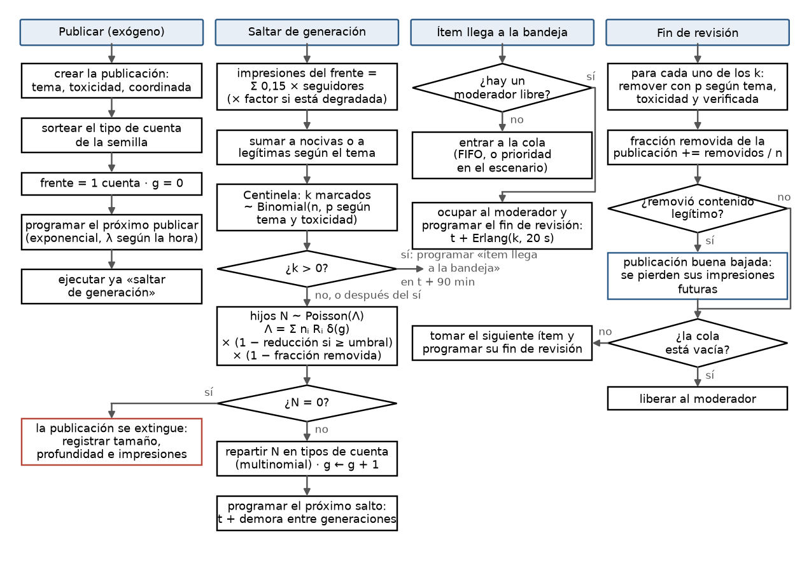
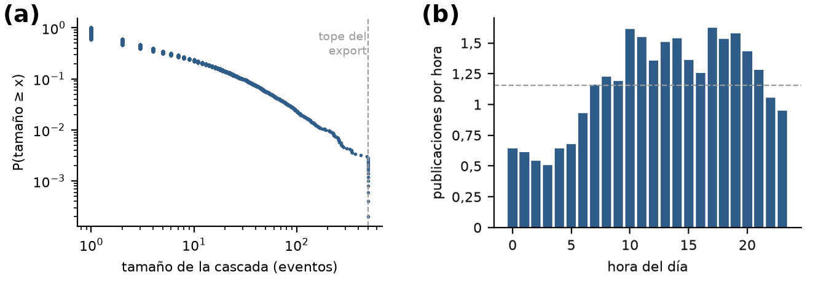
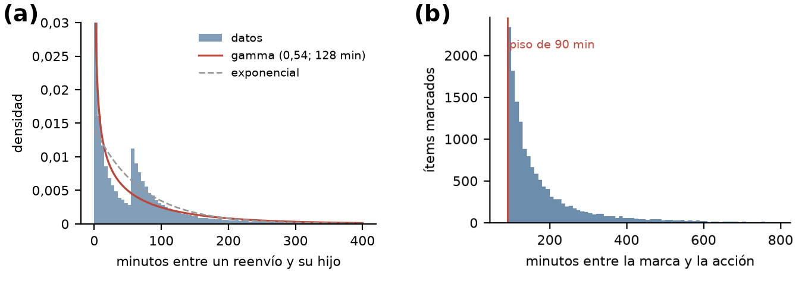
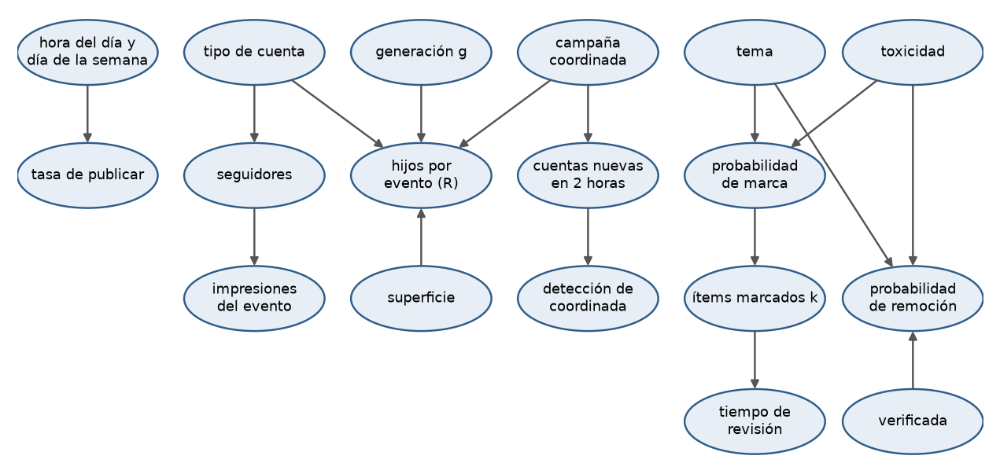
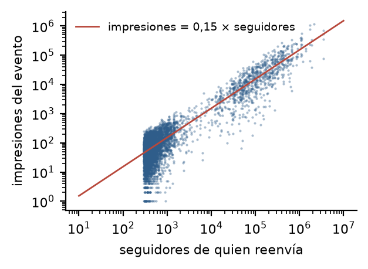

Difusión de rumores y evaluación de contramedidas

Justo Conrado Celsi (65548) · Ian [apellido y legajo] · Gonzalo [apellido y legajo]

11.87 Investigación de Operaciones II · Segundo cuatrimestre 2026 · Instituto Tecnológico de Buenos Aires

# Objetivo

## Definición del problema

RedBaires es una red social de 7,8 millones de usuarios activos diarios que factura por impresión servida, así que todo lo que circula, incluido el contenido nocivo, le genera ingreso. Después del rumor falso sobre PagoYá del 14 de junio, la Dirección de Confianza y Seguridad quiere saber cuál de tres palancas conviene adoptar antes del próximo episodio, en qué intensidad y cuánto rinde cada una por peso invertido: ampliar la moderación (más moderadores o un clasificador mejor), poner fricción a los reenvíos o degradar el alcance de las cuentas coordinadas que se logren detectar.

Las tres palancas tienen el mismo problema. Contener el daño cuesta alcance legítimo, que es de lo que vive la empresa, y moderar de más baja contenido de usuarios que no hicieron nada malo. Nuestro objetivo es construir un modelo de eventos discretos que reproduzca cómo se propagan hoy las publicaciones en la plataforma y que permita comparar las palancas por las impresiones nocivas que evitan contra las impresiones legítimas que se pierden, con un costo total que ordene las alternativas. El modelo también tiene que mostrar en qué condiciones una medida que hoy parece cara se vuelve imprescindible.

## Alcance

Modelamos la vida de cada publicación desde que se publica hasta que deja de reenviarse, la marca automática de Centinela y la cola de moderación humana que actúa sobre lo marcado. No modelamos usuarios: las cuentas son atributos del frente de reenvíos de cada publicación, como pide la condición de no instanciar una entidad por persona. El horizonte es un mes de operación, y de cada corrida informamos también el peor episodio del mes, que es lo que el Directorio llama «otro 14 de junio».

La muestra tiene 5.000 publicaciones en 180 días, unas 28 por día, y es un recorte de la plataforma. Con ese volumen entran 86 ítems marcados por día, un moderador está ocupado el 2 % del tiempo y la palanca de los moderadores no puede hacer nada. Por eso la escala del modelo no se deduce de la muestra: la elegimos. Subimos la tasa de publicación hasta que, con el moderador de hoy, la espera en la cola reproduzca la latencia observada (sección 3.5). El factor que resulta es de alrededor de 50, unas 1.400 publicaciones por día.

Tomamos muchas decisiones de modelado. Las que no salen del enunciado ni se pueden medir en los datos quedan como supuestos, cada uno con su justificación y dentro del análisis de sensibilidad:

| Supuesto | Por qué |
|--------------------------------------|--------------------------------------------------------------|
| Nocivo es todo contenido con tema DISARM; legítimo, el de tema ORG | DISARM es el marco de técnicas de desinformación que usa Centinela, y sus cinco códigos de la muestra son técnicas documentadas. Con esta definición, el 40 % de las impresiones es nociva |
| Centinela clasifica al instante, sin cola | la latencia no sube con la carga (Spearman 0,016), no cambia con la hora y no baja para los temas sensibles; ninguna palanca compra velocidad de clasificación |
| La latencia es una demora fija de 90 minutos más la espera en la cola | ninguna acción ocurre antes de los 90 minutos; lo que pasa por encima de ese piso es lo único que puede depender de la cantidad de moderadores |
| Revisar un ítem marcado lleva unos 20 segundos | el costo de 0,12 USD por ítem revisado, dividido por los 22 USD por hora del moderador |
| Los moderadores trabajan todos igual | no hay datos por moderador |
| La remoción se aplica como fracción del frente, con probabilidad p = toxicidad × 1,5 en temas sensibles (DISARM, política, salud) y × 1 en el resto, a la mitad si la cuenta es verificada | el enunciado dice que la remoción depende del tema y del puntaje y que hay indulgencia con las verificadas; el registro guarda la marca pero no la acción, así que p no se puede estimar |
| Los R medidos describen la propagación con la moderación de hoy | en el registro, los padres marcados tienen tantos hijos nacidos después de la acción como los no marcados (0,069 contra 0,067): la remoción de hoy no deja rastro. Si el modelo base queda por debajo del tamaño observado, se recalibran los R |
| Una publicación es coordinada si tiene el sufijo C2 en su identificador de campaña | es el único sufijo de dos caracteres; esas publicaciones generan 42,8 eventos contra 9,8 y tienen el doble de cuentas nuevas |
| La regla que detecta coordinadas señala una publicación si entre sus reenvíos de las primeras dos horas aparece al menos una cuenta de menos de 30 días | combina el identificador de campaña y la cuenta nueva, que son las señales que da el enunciado. Contra el sufijo C2 tiene precisión 0,21 y recall 0,47, y ese error es parte del costo de degradar: degrada publicaciones legítimas y deja pasar campañas |
| La degradación baja a la mitad el alcance y los reenvíos de la publicación detectada | el CSV da su costo pero no su intensidad; la probamos entre 30 y 80 % |
| Las 14 cascadas cortadas en 500 eventos no entran en la estimación de R, y las simuladas se cortan en 500 para validar | el export corta en 500; así se compara en igualdad de condiciones |

# Modelo conceptual

## Variables de decisión

Los rangos salen de `parametros_y_costos.csv`. En la degradación y en el clasificador el CSV da cuánto cuesta la palanca, no cuánto se la mueve.

| Variable de decisión | Hoy | Rango | Costo de la decisión |
|----------------------------------|----------|------------|--------------------------------------------|
| Moderadores por turno *c* | 1 | 1 a 12 | 22 USD/h: 15.840 USD por moderador por mes |
| Umbral del límite de reenvíos: reenvíos acumulados de la publicación a partir de los cuales se aplica la fricción | sin límite | 1 a 20 | pérdida de engagement legítimo, 15 % (2 a 50 %) |
| Reducción del límite: cuánto baja la descendencia de la publicación que pasó el umbral | 0 | 0 a 0,9 | la misma pérdida |
| Degradación de alcance de las publicaciones detectadas como coordinadas | no | sí o no | 120 USD por cuenta degradada por día (20 a 600) |
| Clasificador nuevo, por su precisión y su recall | 0,72 y 0,63 | 0,5 a 0,95 y 0,3 a 0,9 | 250.000 USD de capex más 60.000 por año, a 4 años y 10 %: unos 11.600 USD por mes |

La degradación es binaria: se aplica a toda publicación que la regla de detección señala o no se aplica. Con un clasificador nuevo, la probabilidad de marcar contenido nocivo pasa a ser el recall elegido, y la de marcar contenido legítimo sale de la precisión.

## Variables de referencia

Una variable de referencia es una salida del simulador: cambia entre corridas y se informa con su intervalo de confianza. Por eso la nómina de moderadores y el costo del clasificador no son variables de referencia. Con *c* moderadores, la nómina ya está determinada antes de correr; es el precio de la decisión y entra en el costo total.

Tomamos dos variables de referencia que se contraponen:

| Variable de referencia | Qué mide | Cómo se calcula |
|------------------------|--------------------------|--------------------------------------------------|
| Impresiones nocivas servidas en el mes | el daño que no se contuvo | suma de las impresiones de los frentes de publicaciones nocivas |
| Impresiones legítimas perdidas en el mes | lo que cuesta contener, del lado del negocio | impresiones legítimas del escenario base con los mismos números aleatorios menos las del escenario, más el 15 % de las impresiones de las publicaciones legítimas que cruzan el umbral de fricción |

Las tres palancas enfrentan a las dos. La fricción y la degradación frenan cualquier publicación que cruce el umbral o que la regla señale, sea nociva o no. La moderación baja lo que revisa, y hoy el 43 % de lo que llega a la cola es contenido legítimo. Por eso ninguna medida mejora las dos a la vez.

Para ordenar las alternativas usamos un costo total en USD por mes, que no es una variable de referencia sino el criterio de decisión:

C = 0,0059 × nocivas servidas + 0,0009 × legítimas perdidas + 1,50 × publicaciones buenas bajadas + 0,12 × ítems revisados + 120 × cuentas-día degradadas + nómina + clasificador

Los coeficientes son los valores base del CSV. Una impresión nociva cuesta 0,004 USD de externalidad más 0,0019 de churn (0,0006 × 3,2 USD por usuario). Los cuatro primeros términos salen de la corrida; los dos últimos son fijos para cada decisión. Las publicaciones buenas bajadas, que cuestan 1,50 USD cada una en reputación, las informamos aparte, porque son el costo de moderar de más que menciona el enunciado.

## Plan de cuadros (conceptual)

| Cuadro | Qué muestra | Para qué |
|-------|--------------------------------------------------|-------------------------------------------|
| 1 | tamaño de las cascadas simuladas (fracción de tamaño 1, p90, p99, profundidad) y latencia mediana, contra lo observado | validar el modelo base antes de usarlo |
| 2 | impresiones nocivas servidas contra impresiones legítimas perdidas, un punto por escenario con su intervalo de confianza y una curva por palanca | ver el intercambio entre las dos variables de referencia y qué palanca queda por delante |
| 3 | costo total por palanca e intensidad, en barras apiladas por componente | elegir la intensidad de cada palanca |
| 4 | daño evitado en USD dividido por el costo de la palanca | contestar «cuál rinde más por cada peso invertido» |
| 5 | ocupación de los moderadores, largo de la cola, publicaciones vivas e ítems en revisión a lo largo del peor episodio | mostrar que el consumo queda acotado, como pide el área de Simulación |
| 6 | costo total de cada palanca a medida que sube el costo social de la impresión nociva (0,001 a 0,05 USD) | encontrar en qué punto una medida cara se vuelve imprescindible |

## Plan de experimentación (conceptual)

Corremos en cinco pasos, siempre con los mismos números aleatorios en todos los escenarios, para que las diferencias sean de la palanca y no del azar:

1. Validamos el modelo base, con un moderador y sin las otras palancas, contra el cuadro 1, y ajustamos el factor de escala para que la latencia mediana dé 139 minutos.
2. Movemos una palanca por vez: *c* de 1 a 6; el umbral en 3, 5, 10 y 20 con reducciones de 0,3, 0,6 y 0,9; la degradación sí o no; el clasificador actual contra dos alternativas (0,85 y 0,75; 0,95 y 0,9).
3. Combinamos las mejores intensidades de cada palanca en un diseño factorial 2³.
4. Corremos las alternativas finalistas en tres escenarios. El conservador usa el costo social mínimo del CSV y 0,9 veces el volumen; el intermedio, los valores base; el pesimista, el costo social máximo y campañas con R de 0,99, a un paso del umbral de explosión.
5. Medimos la sensibilidad a los supuestos: la probabilidad de remoción entre 0,5 y 1,5 veces, la intensidad de la degradación entre 30 y 80 %, el tiempo de revisión en 10, 20 y 40 segundos, y la forma de la demora entre generaciones.

La cantidad de réplicas se calcula en el TP3B a partir de una corrida piloto de 30 réplicas, para que el intervalo de confianza del costo total quede por debajo del 5 % de su media. Elegimos la alternativa de menor costo total. Si dos intervalos se solapan, preferimos la de menos impresiones legítimas perdidas.

## Diagrama de proceso

{width=88%}

Cada publicación da vueltas por A2, A3 y A4 una vez por generación, mientras le queden reenvíos. La moderación, A5 y A6, corre en paralelo sobre otra entidad, el ítem de moderación, y vuelve a la publicación sólo a través de la fracción removida. El problema se juega en la carrera entre los dos lazos. Una publicación salta de generación cada 43 minutos en la mediana y hoy la acción llega a los 139, así que cuando el moderador abre un ítem, la publicación ya avanzó unas tres generaciones.

## Eventos destacados y lógicas

{width=92%}

Publicar es el único evento exógeno. Saltar de generación concentra la lógica de la propagación: expone el frente, lo clasifica y sortea el frente siguiente con un solo sorteo de Poisson, en lugar de uno por reenvío. Las tres palancas entran en ese sorteo o en las impresiones: la degradación multiplica el alcance, el límite multiplica Λ una vez que la publicación pasó el umbral y la remoción lo multiplica por lo que queda del frente. Los dos eventos de la derecha son una cola de *c* servidores. El ítem llega a la bandeja 90 minutos después de la marca, que es el piso de la latencia.

## Variables aleatorias, parámetros y relación entre ellos

Las variables aleatorias del modelo son nueve: el tiempo entre publicaciones, el tipo de cuenta de la semilla, la cantidad de hijos de cada frente, los tipos de cuenta del frente hijo, los seguidores de cada cuenta, la demora entre generaciones, la cantidad de ítems marcados de cada frente, el tiempo de revisión y la remoción de cada ítem. Los parámetros fijos son los hijos medios por tipo de cuenta, el decaimiento por generación, la relación entre impresiones y seguidores, la demora fija de 90 minutos, la regla de detección de coordinadas y los costos del CSV. Cómo se cuantifica cada uno está en la tabla diccionario (sección 3.1) y cómo se relacionan entre sí, en la sección 3.4.

## Elementos del simulador

### Entidades

La entidad principal es la publicación: la pieza de contenido original, que nace en el evento publicar y muere cuando su frente se queda sin reenvíos. Usamos «cascada» sólo para el árbol de reenvíos de una publicación, que es lo que mide el dataset. Elegimos la publicación, y no el reenvío, porque la cantidad de entidades vivas tiene que quedar acotada: hay una por rumor activo, sea su cascada de dos eventos o de tres millones. Probamos antes un lote por generación, pero se crea y se destruye en cada salto, y la remoción, que llega 139 minutos después de la marca, encontraba muerta a la entidad sobre la que tenía que actuar. La segunda entidad es el ítem de moderación, que nace cuando Centinela marca *k* reenvíos de un frente. Si la publicación hiciera la cola ella misma, dejaría de propagarse mientras espera, y en los datos eso no pasa.

### Atributos

La publicación lleva el tema, la toxicidad, si es coordinada, si la regla la detectó, la generación *g*, el frente como cantidad de reenvíos vivos de cada tipo de cuenta, los reenvíos acumulados, la fracción removida y las impresiones nocivas y legítimas acumuladas. El ítem de moderación lleva la publicación de origen, *k*, el tema, la toxicidad, la fracción de cuentas verificadas y la hora de la marca.

### Variables

Las variables de estado son la ocupación de los moderadores, el largo de la cola de moderación, las publicaciones vivas y los ítems en revisión. Las dos últimas prueban que el consumo queda acotado en el peor episodio. Todas se actualizan en los eventos que las cambian y no de forma cíclica.

### Recursos

Los moderadores, *c* por turno, son el único recurso con capacidad.

### Colas

La cola de moderación, FIFO en el modelo base. Aunque el enunciado dice que la cola no es un FIFO puro, en los datos la espera no baja para lo más tóxico ni para los temas sensibles. La diferencia de trato está en la probabilidad de remoción. La prioridad por toxicidad y por tema sensible queda como escenario, porque es una palanca sin costo que la Dirección no listó.

### Eventos

Publicar, saltar de generación, ítem llega a la bandeja y fin de revisión (figura 2), más el fin de la corrida, que cierra el mes y registra el peor episodio.

# Modelo de Datos

## Tabla diccionario

En el formato de la clase 06, cada elemento del modelo conceptual con su cuantificación.

| Variable | U.M. | Valor | Tipo de función | Parámetros | Relación / expresión |
|--------------------|--------|----------|-----------|----------------------------|-----------------------|
| Tiempo entre publicaciones | h | 1/λ(h) | exponencial | λ = 1,16/h en la muestra, por hora del día | λ × factor de escala ≈ 50 |
| Tipo de cuenta de la semilla | tipo | | discreta | STANDARD 39 %, AGGREGATOR 18 %, CREATOR 17 %, LURKER 15 %, BROADCASTER 12 % | |
| Tipos del frente hijo | tipo | | multinomial | STANDARD 50 %, AGGREGATOR 22 %, LURKER 20 %, CREATOR 5 %, BROADCASTER 3 % | |
| Seguidores | cuentas | | empírica por tipo | medianas: BROADCASTER 422.000, CREATOR 101.000, resto unos 410 | |
| Impresiones del evento | impresiones | 0,15 | determinística | | 0,15 × seguidores × (1 − d si está degradada) |
| Hijos por evento Rᵢ | hijos | 0,92 | tabla por tipo | 4,44 · 3,52 · 0,59 | |
| Decaimiento δ(g) | factor | | tabla | 2,33 en g = 0; 1 en g = 1; 0,37 en g = 11 | hijos medios de g ÷ hijos medios de g = 1 |
| Hijos del frente | reenvíos | Λ | Poisson | | Λ = Σ nᵢ Rᵢ δ(g) (1 − r) (1 − f) |
| Demora entre generaciones | min | 70 media, 43 mediana | gamma | forma 0,55 · escala 128 | |
| Probabilidad de marca | fracción | 0,23 | tabla | tema × quintil de toxicidad | |
| Ítems por frente marcado *k* | ítems | 2,6 media | binomial | n, p de marca | |
| Demora fija de moderación | min | 90 | constante | | |
| Tiempo de revisión | s | 20 × k | Erlang | k fases de 20 s | 0,12 USD ÷ 22 USD/h |
| Moderadores *c* | personas | 1 | VD | 1 a 12 | |
| Probabilidad de remoción | fracción | | Bernoulli | toxicidad × 1,5 o 1 × 0,5 si verificada | |
| Umbral de fricción *u* | reenvíos | 5 | VD | 1 a 20 | |
| Reducción de fricción *r* | fracción | 0 | VD | 0 a 0,9 | |
| Detección de coordinada | sí o no | | regla | precisión 0,21 · recall 0,47 contra C2 | ≥ 1 cuenta de menos de 30 días en las primeras 2 h |
| Degradación *d* | fracción | 0,5 | supuesto | 0,3 a 0,8 | aplica si la regla detecta |
| Costo de la impresión nociva | USD | 0,0059 | constante | 0,0011 a 0,098 | 0,004 + 0,0006 × 3,2 |
| Valor de la impresión legítima | USD | 0,0009 | constante | 0,0003 a 0,003 | |

## Análisis y cuantificación de variables

### Método de recolección, proceso de obtención

Todos los datos son de consulta, no de medición en campo: el registro de eventos `muestra_cascadas_REDBAIRES.csv` (66.153 filas, 30 columnas, 5.000 publicaciones en 180 días) y los parámetros de Finanzas en `parametros_y_costos.csv`. La documentación de los campos se perdió, así que reconstruimos qué es cada columna a partir de sus valores:

| Columna | Qué es | Cómo lo verificamos |
|------------------------|----------------------------------------|------------------------------------|
| `parent_event_id` y `cascade_depth` | padre del evento y generación | la profundidad es la del padre más uno en el 100 % de los eventos |
| `reshare_count_from_actor` | hijos del evento | coincide en el 100 % con contar cuántas veces aparece como padre |
| `inter_event_time_min` | minutos desde el padre | coincide en el 99,8 % con la resta de fechas |
| `topic_code` | tema: cinco códigos DISARM (T0003, T0023, T0039, T0049, T0049.003) y cinco orgánicos (POL, HLTH, FIN, CELEB, LOCAL) | los DISARM son técnicas del marco oficial de DISARM Foundation |
| `account_type_code` | rol: difusor masivo, creador, reposteador, durmiente, estándar | los roles que nombra el enunciado |
| `hashtag_cluster_ref` | identificador de campaña; el sufijo C2 marca coordinación | es el único sufijo de dos caracteres y tiene las 14 cascadas cortadas |
| `moderation_flag` y `moderation_latency_min` | marca de Centinela y minutos hasta la acción | la latencia sólo existe en eventos marcados |
| `content_half_life_min` | vida media de la pieza | un solo valor por publicación; no correlaciona con el tamaño (Spearman 0,04) |

Los niveles nano, micro, macro y mega del enunciado no están en los datos. Con los cortes usuales de 1.000, 10.000, 100.000 y un millón de seguidores, el 80 % de los eventos queda por debajo de todos, así que usamos el tipo de cuenta. Las columnas de likes, comentarios, tiempo de visualización, sentimiento, idioma y huella de dispositivo no entran al modelo. La huella tampoco sirve para detectar coordinación: el 99,9 % aparece en más de tres publicaciones, dentro y fuera de C2.

Antes de medir limpiamos 132 filas duplicadas, 39 fechas en 2099 y las mayúsculas mezcladas de formato, superficie e idioma, unas 13.800 celdas. Además dejamos fuera 196 latencias de más de un día, 66 tiempos de visualización negativos y 39 tiempos entre eventos negativos, cuyas fechas de padre e hijo sí están en orden, y tomamos como faltantes los 625 eventos sin impresiones. Los 514 eventos de 36 cuentas con antigüedad anterior a la plataforma y las 3.627 cuentas con más de un valor de seguidores no cambian ninguna estimación: los seguidores se toman al momento del evento.

## Análisis estadístico

{width=82%}

El tamaño de las cascadas tiene la forma que describe el enunciado: muchísimas diminutas y unas pocas enormes, y el 1 % más grande concentra el 24 % de las impresiones. El factor de multiplicación, medido como hijos medios por evento sin las cascadas cortadas, es 0,916. Por otro camino, 1 − 1/tamaño medio, da lo mismo, así que el proceso es subcrítico: en promedio, cada rumor se apaga solo. La varianza de los hijos es unas 5 veces su media, así que no es un Poisson simple. La sobredispersión sale de mezclar tipos de cuenta: un BROADCASTER genera 4,44 hijos y una cuenta estándar 0,59.

Las publicaciones llegan con tasa variable, de 0,51 por hora a las 3 a 1,62 a las 17, y los sábados y domingos traen un 20 % más que el resto de la semana. Dentro de la franja de 10 a 19 horas, el tiempo entre publicaciones tiene un coeficiente de variación de 1,04 y la prueba de Kolmogorov-Smirnov contra una exponencial da D = 0,014. Por eso usamos llegadas exponenciales con tasa por hora.

{width=82%}

### Ajuste a distribuciones

Para la demora entre generaciones ajustamos cuatro distribuciones a 60.717 tiempos positivos. Con tantos datos ninguna pasa la prueba de Kolmogorov-Smirnov, así que elegimos la que más se acerca: la gamma de forma 0,55 y escala 128 minutos (D = 0,080). Después vienen la Weibull (0,106), la lognormal (0,142) y la exponencial (0,151). No puede ser una Erlang: la Erlang es una gamma de forma entera, con un coeficiente de variación de 1/√k que nunca pasa de 1, y estos tiempos tienen 3,9. La Erlang sí la usamos para el tiempo de revisión, donde un ítem con *k* marcados son *k* fases sucesivas de unos 20 segundos.

En la figura 4a se ve algo que la gamma no captura. A los 55 minutos la frecuencia salta de golpe, de unos 170 tiempos por minuto a unos 750, y el salto aparece igual en todas las superficies, tipos de cuenta, formatos y generaciones. Lo leemos como dos canales de reenvío: el 63 % llega directo, con una gamma de media 25 minutos, y el 37 % llega con una demora mínima de 55 minutos, que podría ser la recomendación del Muro. Esa mezcla ajusta con D = 0,021. Mantenemos la gamma en el modelo base y probamos la mezcla en la validación del TP3B.

La latencia de moderación tiene un piso duro de 90 minutos, una mediana de 139 y un p90 de 353. No depende de la carga: la correlación con los ítems marcados en la hora previa es 0,016 y la mediana por hora va de 131 a 148 minutos, aunque las llegadas se triplican entre la madrugada y la tarde. Por eso la separamos en una demora fija de 90 minutos y una espera en cola. Lo que está por encima del piso, con mediana de 49 minutos y media de 106, es lo que calibramos con el factor de escala.

## Relación entre variables

### Modelos de relación

{width=78%}

Los hijos por evento dependen sobre todo del tipo de cuenta, y en mucho menor medida de la superficie (0,55 en mensajes directos contra 1,12 en grupos) y del formato (0,77 a 0,95). No dependen del tema: las publicaciones nocivas tienen 0,914 hijos por evento y las legítimas 0,919, así que el daño viene de dónde cae el rumor y no de qué dice. Los hijos bajan con la generación también dentro de cada tipo de cuenta: una cuenta estándar pasa de 0,70 en la primera generación a 0,41 en la séptima. Por eso el decaimiento δ(g) multiplica a los Rᵢ en vez de reemplazarlos.

Las impresiones de un evento son proporcionales a los seguidores de quien reenvía. La mediana del cociente es 0,15 y da 0,151 a 0,156 en los cinco tipos de cuenta, con un p10 de 0,04 y un p90 de 0,38. Una regresión lineal por el origen da una pendiente de 0,19 y un R² de 0,64, pero la arrastran las cuentas grandes, así que usamos la mediana.

{width=42%}

La probabilidad de que Centinela marque un evento sube con la toxicidad y es el doble en los temas DISARM. Por quintil de toxicidad va de 20 % a 40 % en DISARM y de 9 % a 26 % en temas orgánicos. La precisión y el recall que da el CSV (0,72 y 0,63) no se reproducen en el registro con ninguna definición de nocivo. Con DISARM dan 0,57 y 0,34, y ni el grupo más marcado de todos, DISARM con toxicidad mayor a 0,9, se marca más del 51 % de las veces. Los tomamos como la especificación de un clasificador nuevo, que es una de las variables de decisión, y no como el Centinela de hoy.

## Evaluación a priori

Estimamos el resultado esperado sin simular, con dos modelos sencillos: el proceso de ramificación para la propagación y una fila M/M/c para la moderación.

Si cada evento genera en promedio R hijos, una cascada suma 1 + R + R² + … = 1/(1 − R) eventos, y se dispara cuando R llega a 1. Con R = 0,916 da 11,9 eventos; en los datos, 11,8. Las publicaciones coordinadas generan 42,8 eventos, que corresponden a R ≈ 0,977: están a dos centésimas del umbral. Por eso la fricción debería rendir mucho sobre ellas. Si una publicación coordinada llega al umbral de 5 reenvíos, los que le siguen suman en promedio 5R/(1 − R) ≈ 212 eventos más. Con una reducción del 10 % bajan a 36, y con una del 30 %, a 11. Pero el mismo límite frena a las legítimas grandes, con R ≈ 0,92: una reducción del 10 % les corta casi el 60 % de lo que generan después del umbral. Esa es la tensión entre las dos variables de referencia.

Para la moderación calibramos la escala. Con 20 segundos por ítem, un moderador revisa 3 ítems por minuto. Para que la espera en una M/M/1 tenga la mediana de 49 minutos que se observa por encima del piso, la ocupación tiene que ser 99,5 %: unos 4.300 ítems marcados por día, 50 veces los de la muestra. Con esa escala, la fila da:

| Moderadores *c* | Ocupación | Probabilidad de esperar | Espera media | Latencia media |
|----------------|----------------|----------------------|--------------------|--------------------|
| 1 | 99,5 % | 99,5 % | 71 min | 161 min |
| 2 | 49,8 % | 33 % | 0,1 min | 90 min |
| 3 | 33,2 % | 9 % | 0 min | 90 min |

Todo el efecto está en el segundo moderador: con dos, la cola desaparece y la latencia queda en el piso de 90 minutos. Del tercero en adelante no cambia nada, salvo que el volumen crezca. El mismo cálculo muestra lo frágil que es la situación de hoy: con 5 % más de volumen, un moderador ya no alcanza y la cola crece sin límite, y en la hora pico el volumen es 1,4 veces el promedio. Pero en los datos la latencia no crece en la hora pico, y una fila no puede reproducir eso. Nos quedamos con la fila porque la escala de 50 veces y el valor del segundo moderador no dependen de lo que pasa en el pico, y declaramos esa diferencia como una limitación del modelo que vamos a mirar en la validación del TP3B.

Para ver cuánto vale acortar la latencia miramos cuándo ocurren las impresiones nocivas. El 32 % llega después de los 139 minutos desde que se publicó el rumor y el 46 %, después de los 90. Con un recall de 0,34 y una probabilidad de remoción cercana a 0,5, el segundo moderador evitaría del orden de (0,46 − 0,32) × 0,34 × 0,5 ≈ 2 % de las impresiones nocivas. Con la escala elegida, las impresiones nocivas cuestan unos 7 millones de USD por mes, así que ese 2 % vale unos 160.000 USD contra los 15.840 que cuesta el moderador. Hay un límite que ninguna capacidad de moderación resuelve: el 26 % de las impresiones nocivas es de la publicación original, antes de cualquier marca. Y los BROADCASTER, que generan el 69 % de las impresiones nocivas, son 100 % verificados, así que la indulgencia con las verificadas cae justo donde está el daño.

# Bibliografía, referencias y anexos

## Bibliografía

Banks, J., Carson, J. S., Nelson, B. L. y Nicol, D. M. (2013). *Discrete-Event System Simulation*, 5.ª ed. Pearson. Capítulos 1, 3, 6 y 9.

Law, A. M. (2014). *Simulation Modeling and Analysis*, 5.ª ed. McGraw-Hill.

Robinson, S. (2008). Conceptual modelling for simulation Part I: definition and requirements. *Journal of the Operational Research Society*, 59(3), 278–290.

Harris, T. E. (1963). *The Theory of Branching Processes*. Springer.

Lloyd-Smith, J. O., Schreiber, S. J., Kopp, P. E. y Getz, W. M. (2005). Superspreading and the effect of individual variation on disease emergence. *Nature*, 438, 355–359.

## Referencias

Vosoughi, S., Roy, D. y Aral, S. (2018). The spread of true and false news online. *Science*, 359(6380), 1146–1151. Encontraron que las noticias falsas llegan más lejos y más rápido que las verdaderas. En nuestra muestra, en cambio, las publicaciones nocivas y las legítimas tienen el mismo R. En RedBaires el daño lo explica quién recibe el rumor, no qué dice.

de Freitas Melo, P., Coimbra Vieira, C., Garimella, K., Vaz de Melo, P. O. S. y Benevenuto, F. (2019). Can WhatsApp counter misinformation by limiting message forwarding? *Complex Networks and Their Applications VIII*, Springer. Concluyen que el límite de reenvíos de WhatsApp demora la difusión pero no frena los contenidos más virales. Es el caso real más cercano a nuestra segunda palanca, y lo vamos a contrastar con lo que dé el simulador.

DISARM Foundation. *DISARM Framework*. github.com/DISARMFoundation/DISARMframeworks. Consultado el 15/9/2026.

## Descripción teórica de temas que exceden los temas tratados en el curso

Un proceso de ramificación de Galton-Watson describe una población en la que cada individuo deja una cantidad aleatoria de descendientes, independiente de los demás, con media R. El tamaño esperado del total es 1/(1 − R) si R < 1, y la población se extingue con probabilidad 1. Si R ≥ 1, crece sin límite con probabilidad positiva. Es el modelo detrás del «factor de multiplicación» del enunciado y del umbral a partir del cual «la difusión crece sola». Nuestro modelo es una versión con tipos: el R de cada reenvío depende del tipo de cuenta, y el frente de cada generación es un vector con cuántos reenvíos hay de cada tipo.
