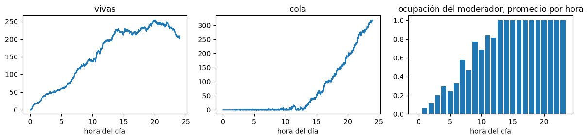
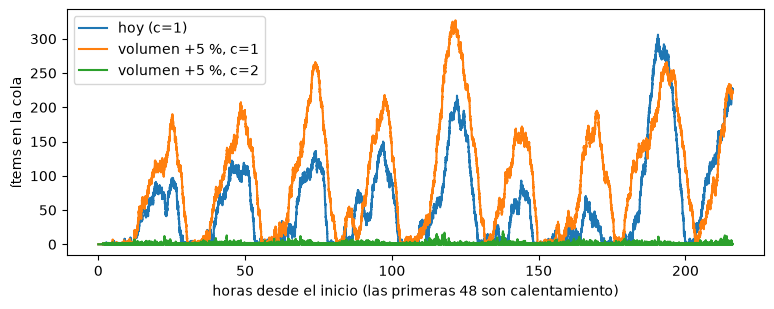

# El simulador

Programamos el simulador en Python con la librería SimPy, que el tutor aceptó con la condición de mostrar a qué bloque de AnyLogic equivale cada parte. El código está en el notebook `simulador.ipynb`, que entregamos con este informe y que tiene los resultados ya calculados, así que se puede leer sin correrlo. Lo armamos en el orden de un pase a mano: primero una publicación sola, después la cola de moderación con seis ítems, un día entero, la validación contra los datos, un mes y, al final, el cálculo de N y el stress test. La figura 1 muestra el flujo dibujado con los bloques que usaríamos en AnyLogic.

{width=100%}

Tabla 1. Equivalencia entre los bloques de AnyLogic y el simulador.

| AnyLogic | En el simulador |
|---|---|
| *Agent type* con parámetros | un diccionario con los atributos de la publicación o del ítem |
| `Source` | el proceso `llegadas`, que espera un tiempo exponencial con la tasa de la hora y crea una publicación |
| `Delay` | `env.timeout(t)`: la demora entre generaciones y el piso de 90 minutos |
| `SelectOutput` | un sorteo y un `if`: si Centinela marca, nace un ítem de moderación |
| `Queue` + `Service` + `ResourcePool` | `simpy.Resource(capacity=c)` y `moderadores.request()` |
| `Sink` | el final de la función del proceso |
| *Statistics*, *Dataset* | el diccionario `VR` y las listas de latencias y tamaños |
| Parámetros del experimento | el diccionario de variables de decisión: `c`, `umbral`, `reduccion`, `degradar`, `clasificador`, `volumen` |

## Entidades

Mantuvimos las dos entidades de la parte A. La publicación es la pieza de contenido original, nace en el evento publicar y lleva como atributos el tema, el índice de toxicidad, si pertenece a una campaña coordinada, si el tema es sensible, el frente de reenvíos vivos por tipo de cuenta, los reenvíos acumulados y la fracción removida. El tema, la toxicidad, la coordinación y el tipo de cuenta de la semilla los sorteamos juntos, tomando con reposición una semilla real de la muestra, para no romper la relación entre ellos que encontramos en la parte A. El ítem de moderación nace cuando Centinela marca *k* reenvíos de un frente y lleva *k*, el tamaño del frente y la fracción de cuentas verificadas que había en él.

Las llegadas son exponenciales con la tasa de la hora del día, como ajustamos en la parte A (Kolmogorov-Smirnov, D = 0,014). La tasa de la muestra va de 0,51 publicaciones por hora a las 3 a 1,62 a las 17, y la multiplicamos por la escala que calibramos en el debugging. Con escala 53 llegan 1.468 publicaciones por día.

## Actividades y flujo

En cada vuelta del lazo pasa el evento saltar de generación, con cuatro pasos:

1. Se expone el frente: cada reenvío suma 0,15 × los seguidores de quien reenvía, sorteados de la muestra de su tipo de cuenta.
2. Centinela marca *k* reenvíos, con *k* binomial y una probabilidad de marca que depende de si el tema es nocivo y del quintil de toxicidad (de 0,09 a 0,40). Si *k* > 0 nace un ítem de moderación.
3. Se sortea el frente siguiente con un solo sorteo de Poisson de media Λ = Σ nᵢ Rᵢ δ(g) · m · (1 − f), y los tipos de cuenta de los hijos con una multinomial. Rᵢ va de 0,58 a 4,44 según el tipo de cuenta y δ(g) baja de 2,33 en la semilla a 0,37 en la generación 11. Aquí *m* es el cociente entre los reenvíos medios de una publicación de campaña coordinada y de una orgánica, que sale de la muestra, y vale 1 si la publicación no es coordinada. Cuando Λ pasa de 300 el sorteo de Poisson se aproxima con una normal de media y varianza Λ.
4. La publicación espera la demora entre generaciones, gamma de forma 0,55 y escala 128 minutos. Si no hubo hijos, sale del sistema.

El ítem de moderación espera los 90 minutos fijos del piso de latencia, entra a la bandeja FIFO y espera un moderador libre. La revisión dura una Erlang de *k* fases de 20 segundos. Al terminar sorteamos cuántos de los *k* se remueven, con probabilidad toxicidad × 1,5 en temas sensibles y la mitad para la fracción de cuentas verificadas, y sumamos removidos / *n* a la fracción removida de la publicación. Desde la generación siguiente esa fracción achica Λ.

Las otras dos palancas están en la misma fórmula. La fricción multiplica Λ por (1 − *r*) cuando los reenvíos acumulados pasan el umbral *u*, y cuenta como perdido el 15 % de las impresiones legítimas que se sirven después (dato del CSV de parámetros). La degradación detecta campañas con la precisión 0,21 y el recall 0,47 que medimos en la parte A, y multiplica el alcance y Λ de las detectadas por 1 − *d*. El clasificador nuevo reemplaza la probabilidad de marca por la que corresponde a su precisión y su recall.

La lógica de la cola la probamos sola antes de juntarla con las publicaciones, con seis ítems marcados en minutos elegidos por nosotros y un moderador, como en el ejemplo de la clase 07. Los tres primeros llegan juntos y se ordenan uno detrás de otro, y ninguno sale antes de los 90 minutos:

Tabla 2. Pase a mano de la cola de moderación con seis ítems.

| Marcado (min) | *k* | Llega a la bandeja | Sale | Latencia (min) |
|---|---|---|---|---|
| 0 | 6 | 90 | 91,7 | 91,7 |
| 0 | 3 | 90 | 92,5 | 92,5 |
| 0 | 4 | 90 | 93,6 | 93,6 |
| 5 | 2 | 95 | 96,1 | 91,1 |
| 30 | 5 | 120 | 120,7 | 90,7 |
| 31 | 1 | 121 | 121,3 | 90,3 |

## Recursos

El recurso es el grupo de *c* moderadores, un `simpy.Resource` que hace de `ResourcePool`. Son idénticos, como decidimos en la parte A, y la asignación es la del bloque `Service`: el primer ítem de la bandeja toma el primer moderador que se libera. El tiempo de servicio crece con los ítems marcados, porque cada uno es una fase de la Erlang. Centinela no es un recurso: marca en el momento, sin cola, como supusimos en la parte A.

## Variables de referencia

Las dos variables de referencia de la parte A se calculan en el evento que las cambia. Las impresiones nocivas servidas se suman en el paso 1 de cada generación. Las impresiones legítimas perdidas no se pueden leer de una sola corrida, porque son lo que el escenario pierde contra el de hoy: las calculamos como la diferencia de impresiones legítimas contra el escenario base corrido con los mismos números aleatorios, más las que pierde la fricción. En el escenario base valen cero. Para el costo total contamos además los ítems revisados y las publicaciones buenas bajadas, que se suman cuando termina cada revisión.

## Variables de estado

Las tres variables de estado que graficamos son el largo de la cola, los moderadores ocupados y las publicaciones vivas. Las anotamos con su valor y el minuto en el momento en que cambian: cuando un ítem entra a la bandeja, cuando empieza y termina una revisión, y cuando nace y muere una publicación. No hay muestreo cada tanto. La ocupación es el promedio en el tiempo de los moderadores ocupados dividido por *c*.

{width=100%}

En la figura 2 se ve que de mañana el moderador alcanza y la cola casi no existe. Desde el mediodía las llegadas pasan su capacidad, el moderador queda ocupado todo el tiempo y la cola crece hasta la noche. En los datos la latencia no sube en la hora pico, así que esta es la limitación que ya habíamos declarado en la parte A.

# Stress test y debugging

## Stress test

Corrimos una semana por escenario, con dos días de calentamiento y la misma semilla, moviendo una variable de decisión por vez.

Tabla 3. Resultados del stress test, una semana por escenario.

| Escenario | Nocivas servidas (millones) | Legítimas perdidas (millones) | Latencia mediana (min) | Cola máxima | Vivas, máximo |
|---|---|---|---|---|---|
| hoy, *c* = 1 | 218,1 | 0 | 114 | 306 | 271 |
| *c* = 2 | 212,2 | 3,7 | 91 | 16 | 261 |
| *c* = 4 | 212,1 | 3,7 | 90 | 6 | 261 |
| volumen +5 %, *c* = 1 | 231,8 | — | 148 | 327 | 294 |
| volumen +5 %, *c* = 2 | 224,1 | — | 91 | 19 | 292 |
| fricción *u* = 5, *r* = 0,3 | 171,3 | 108,4 | 92 | 39 | 228 |
| degradación | 175,9 | 61,7 | 93 | 134 | 229 |
| clasificador 0,85 / 0,75, *c* = 1 | 241,0 | −11,9 | 2.639 | 9.026 | 293 |

El simulador respondió como esperábamos en casi todo. El segundo moderador lleva la latencia al piso de 90 minutos y del tercero en adelante no cambia nada, igual que en la evaluación a priori. La fricción y la degradación bajan las nocivas un 21 % y un 19 %, pero son las que más impresiones legítimas pierden. Las publicaciones vivas quedan acotadas en todos los escenarios. En los de volumen no informamos legítimas perdidas, porque cambian las publicaciones que llegan y no hay contra qué compararlas.

Hubo dos resultados que no esperábamos. La evaluación a priori decía que con 5 % más de volumen y un moderador la cola crecería sin límite, y la figura 3 muestra que se arma de tarde y se vacía de noche, porque la tasa de llegadas baja mucho de madrugada. El clasificador nuevo con un solo moderador da más impresiones nocivas que hoy: marca el doble de ítems, la cola llega a 9.026 y las remociones llegan casi dos días tarde, cuando la cascada ya terminó; por eso también baja menos publicaciones legítimas que hoy y la columna de perdidas da negativa. Un clasificador mejor sin más moderadores empeora las cosas, y eso lo vamos a medir en la parte C.

{width=85%}

## Debugging

Además de los dos pases a mano, el de una publicación sola y el de la cola con seis ítems, dejamos en el notebook tres controles que corremos después de cada cambio. Si alguno falla, hay un error en el simulador:

Tabla 4. Controles de debugging, con *c* = 2 y una semana.

| Control | Esperado | Medido (*c* = 2, una semana) |
|---|---|---|
| ninguna latencia menor al piso | ≥ 90 min | mínimo ≥ 90 |
| ley de Little en la cola | L = λ · W = 0,343 | L = 0,352 |
| ocupación contra el balanceo λ · E[servicio] / *c* | 0,448 | 0,443 |

Con el modelo controlado lo validamos contra los datos y calibramos la escala, que es lo único que no sale de la muestra. El tamaño de las cascadas y la fracción nociva no dependen de la escala, la latencia sí:

Tabla 5. Latencia mediana de un mes según la escala, con dos semillas.

| Escala | Latencia mediana en un mes (min), dos semillas |
|---|---|
| 50 | 104 · 111 |
| 52 | 115 · 131 |
| 53 | 130 · 135 |
| 54 | 581 · 169 |

Tabla 6. Validación contra los datos con escala 53.

| Con escala 53 | Observado | Simulado |
|---|---|---|
| latencia mediana (min) | 139 | 135 |
| fracción de impresiones nocivas | 0,41 | 0,41 |
| tamaño medio de la cascada | 11,8 | 12,3 |
| tamaño p90 | 28,5 | 34 |
| tamaño p99 | 151 | 69 |

Nos quedamos con 53. Todo valida salvo el p99 del tamaño: el modelo genera la mitad de cascadas enormes que las reales, y son las que más daño hacen. La parte A preveía recalibrar los R si pasaba esto, y lo hacemos en la parte C.

# Funcionalidades no vistas en clase

Como no usamos AnyLogic, elegimos dos cosas del simulador que no vimos en clase y que resolvieron un problema concreto.

La primera son los números aleatorios comunes. Cada publicación, cada generación y cada ítem de moderación tienen su propio generador, sembrado con su número, y los sorteos de Poisson, binomial y gamma se hacen por la inversa de la acumulada. Así dos escenarios ven las mismas publicaciones, y si la palanca cambia la media de un sorteo, el mismo número aleatorio da el mismo resultado o uno vecino. Con el piloto del cálculo de N, el desvío de la diferencia entre uno y dos moderadores dio 8,1 millones de impresiones nocivas, contra 20,9 de un escenario solo. Con escenarios independientes el desvío de la diferencia sería √2 · 20,9 ≈ 29,6, y N habría sido (29,6 / 8,06)² · 238 ≈ 3.200 meses en vez de 238.

La segunda es la verificación automática con la teoría de filas. Como las variables de estado se anotan en cada evento, su promedio en el tiempo es exacto y no depende de un período de muestreo. Con eso comprobamos en cada corrida la ley de Little y la ocupación del balanceo de la tabla de debugging, en lugar de mirarlas a ojo en un gráfico.

# Dificultades de codificación y cambios respecto de la parte A

Tabla 7. Cambios respecto de la parte A.

| Qué | En la parte A | En el simulador | Por qué |
|---|---|---|---|
| escala | 50, con una M/M/1 | 53 | el tiempo de revisión es Erlang, y calibramos sobre un mes en vez de cinco días |
| error admitido para N | 5 % de la media del costo | ±7.920 USD por mes, sobre la diferencia entre escenarios | la cátedra pide un error absoluto (clase 02), y medio moderador es la decisión más chica que hay que distinguir |
| piloto | 30 réplicas | 6 pares de meses | cada par tarda alrededor de un minuto, y con 5 grados de libertad la t es más grande, así que N sale por exceso |
| transitorio | no lo habíamos tratado | descartamos 2 días al principio de cada corrida | la cola arranca vacía y con un moderador al 94 % tarda en llegar al régimen (clase 08) |
| remoción en cuentas verificadas | la mitad si la cuenta es verificada | la mitad por la fracción de verificadas del frente | un ítem junta reenvíos de varias cuentas |
| volumen +5 % con un moderador | la cola crece sin límite | se arma de tarde y se vacía de noche | la tasa de llegadas cambia con la hora |

La dificultad más grande fue la escala. Primero la calibramos con corridas de cinco días y salió 54, pero en un mes esa escala hace crecer la cola sin parar en una de las dos semillas. Con un moderador cerca del 100 % de ocupación, 2 % más de volumen cambia todo, que es la fragilidad que la evaluación a priori ya anticipaba.

La segunda fue que dos escenarios fueran comparables. Con un generador común a toda la corrida, bastaría que una remoción cambiara un frente para que todos los sorteos siguientes se corrieran y las dos corridas dejaran de ver las mismas publicaciones. Por eso usamos un generador por publicación y por generación, y un solo sorteo de Poisson por generación con la media de todo el frente, que da la misma distribución que sortear cada reenvío porque la suma de Poisson independientes es Poisson.

La tercera es una limitación que no resolvimos: en una fila la latencia sube en la hora pico, y en los datos no. La declaramos en la parte A y la figura 2 la muestra. Queda abierta para la parte C, junto con el p99 de las cascadas y la mezcla de dos canales para la demora entre generaciones, que la parte A dejó para la validación.

# Cálculo de N y resultado en condiciones iniciales

Las condiciones iniciales son las de hoy: un moderador, sin fricción, sin degradación y con el Centinela actual. Una réplica es un mes de 30 días, que es el horizonte de la parte A, después de descartar dos días de calentamiento.

Fijamos el error admitido desde la decisión más chica que hay que poder distinguir, que es sumar un moderador. Cuesta 15.840 USD por mes, así que pedimos que el intervalo de la diferencia entre escenarios no tenga más de la mitad de semiamplitud, ±7.920 USD. A 0,0059 USD por impresión nociva son ±1,34 millones de impresiones por mes. Corrimos un piloto de seis meses con uno y con dos moderadores, con los mismos números aleatorios, y aplicamos la fórmula de la clase 02 a la diferencia:

N ≥ (s₀ · t₀,₀₂₅; ₅ / ε)² = (8,06 × 10⁶ · 2,571 / 1,34 × 10⁶)² = 238

Tabla 8. Piloto para el cálculo de *N*.

| Piloto | |
|---|---|
| desvío de la diferencia, s₀ | 8,06 millones de impresiones nocivas |
| t de Student, 5 grados de libertad | 2,571 |
| error admitido, ε | 1,34 millones de impresiones (7.920 USD) |
| **N** | **238 meses por escenario, unos 7.140 días** |

Cada mes simulado tarda alrededor de medio minuto, así que 238 réplicas son unas dos horas por escenario. Si en la parte C no alcanza el tiempo para todos los escenarios, relajamos el error a un moderador entero, ±15.840 USD, y N baja a la cuarta parte.

El resultado en las condiciones iniciales, con una corrida y con las seis réplicas del piloto:

Tabla 9. Resultado en condiciones iniciales, por mes.

| Condiciones iniciales, por mes | Una corrida | Media de 6 réplicas ± IC 95 % |
|---|---|---|
| impresiones nocivas servidas (millones) | 948,7 | **958,9 ± 21,9** |
| impresiones legítimas servidas (millones) | 1.482 | 1.498 ± 41 |
| publicaciones buenas bajadas | 21.325 | 21.479 ± 503 |
| ítems revisados | 120.922 | 121.611 ± 2.195 |
| latencia mediana (min) | 130 | 135 ± 19 |
| ocupación del moderador | — | **0,936 ± 0,018** |
| ítems en la cola, promedio | — | 94 ± 40 |
| costo del mes (miles de USD) | 5.660 | **5.720 ± 130** |

El costo del mes es el criterio de decisión de la parte A con lo que sale de la corrida: 0,0059 USD por impresión nociva, 1,50 por publicación buena bajada, 0,12 por ítem revisado y la nómina de un moderador. Casi todo es daño nocivo. La segunda variable de referencia vale cero, porque este es el escenario contra el que se miden los demás.

Con las mismas seis réplicas ya tenemos un primer resultado para la parte C. El segundo moderador evita 28,2 ± 8,5 millones de impresiones nocivas por mes, unos 166.000 USD, y pierde 16,4 ± 4,5 millones de impresiones legítimas, unos 14.800 USD, contra los 15.840 que cuesta. El intervalo es todavía seis veces más ancho que el error admitido, que es lo que dice N.

# Bibliografía y referencias

Cátedra de Investigación de Operaciones II (2026). *Clase 02: tamaño de muestra y error admitido*; *Clase 07: filas*; *Clase 08: régimen transitorio y estacionario*. ITBA.

Law, A. M. (2015). *Simulation Modeling and Analysis* (5.ª ed.), cap. 11, «Variance-reduction techniques». McGraw-Hill.

Team SimPy (2023). *SimPy: discrete event simulation for Python*, versión 4.1. https://simpy.readthedocs.io

Grupo (2026). *TP3A: RedBaires · modelo conceptual y de datos*. Entregado el 2/10/2026.
